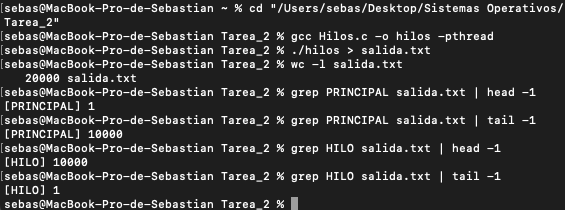

# Tarea 2: Creación de un hilo (POSIX Threads)

- **Materia:** Sistemas Operativos
- **Alumno:** Moreno Saenz Sebastian
- **Boleta:** 2025630357
- **Grupo:** 4CM1

## Descripción

Programa en C que crea un hilo con la biblioteca POSIX `pthread`. El proceso principal y el hilo se ejecutan de forma concurrente:

- **Proceso principal:** imprime los números del 1 al 10,000.
- **Hilo:** imprime los números del 10,000 al 1.

El proceso principal crea el hilo con `pthread_create()`, imprime su propia cuenta y al terminar espera al hilo con `pthread_join()`.

## De procesos a hilos

|                             | Tarea 1                              | Tarea 2                                                          |
| --------------------------- | ------------------------------------ | ---------------------------------------------------------------- |
| Mecanismo                   | `fork()` (procesos)                  | `pthread_create()` (hilo)                                        |
| Memoria                     | Cada proceso tiene su propio espacio | El hilo comparte el espacio de memoria del proceso               |
| Espera                      | `wait()`                             | `pthread_join()`                                                 |
| Identificación en la salida | PID de cada proceso                  | Etiqueta `[PRINCIPAL]` / `[HILO]` (ambos comparten el mismo PID) |

## Entorno

- Sistema operativo: macOS (entorno UNIX, autorizado por el profesor)
- Compilador: gcc (clang de Xcode Command Line Tools)
- Biblioteca: pthread

## Archivos

- `Hilos.c`: código fuente
- `salida.txt`: salida completa de una ejecución (20,000 líneas)
- `img/Evidencia.png`: captura de la compilación y ejecución en macOS

## Compilación y ejecución

```bash
gcc Hilos.c -o hilos -pthread
./hilos > salida.txt
```

## Evidencia de ejecución



## Nota sobre la salida

El proceso principal y el hilo se ejecutan de forma concurrente, por lo que sus líneas aparecen intercaladas y el orden cambia en cada ejecución. Es el comportamiento esperado, no un error. Se desactiva el búfer de `stdout` con `setvbuf` para que el intercalado se vea tal como ocurre.

Ambos solo comparten `stdout` y no modifican variables comunes, por lo que no se requiere un mutex para este problema.
